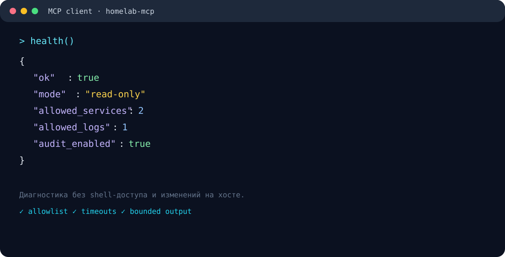
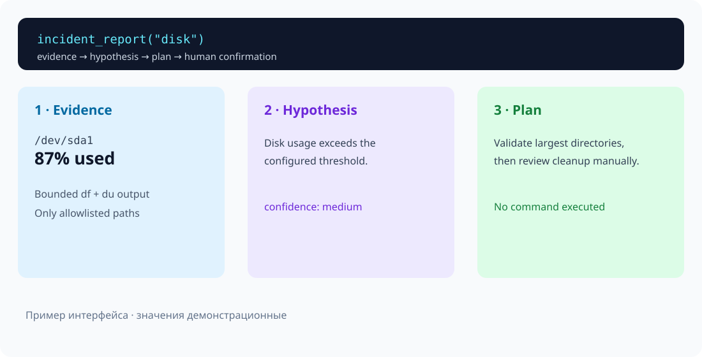

<p align="center">
  
</p>

<p align="center">
  <a href="https://github.com/lstkhN/homelab-mcp/actions"></a>
  <a href="https://github.com/lstkhN/homelab-mcp/blob/main/LICENSE"></a>
  <a href="https://www.python.org/"></a>
  <a href="https://modelcontextprotocol.io/"></a>
</p>

<h1 align="center">Безопасная диагностика homelab через MCP</h1>

<p align="center">
  Read-only MCP-сервер для Linux: allowlist, bounded output, audit и никаких
  автоматических изменений на хосте.
</p>

`homelab-mcp` — MCP-сервер для безопасной диагностики небольшого домашнего
Linux-сервера (homelab). Он подключается к MCP-клиенту через **stdio** и
предоставляет только ограниченный набор операций чтения.

Проект подходит, если нужно спрашивать у совместимого с MCP ассистента,
например, «сколько места осталось на диске?» или «запущен ли nginx?», не
выдавая ассистенту произвольный доступ к shell.

> **Важно:** сервер не выполняет команды, предложенные моделью, не меняет
> состояние системы и не предоставляет SSH, shell или доступ к секретам.

## Возможности

- проверка состояния сервера и настроек allowlist;
- загрузка uptime и использования памяти;
- проверка места только на явно разрешённых точках монтирования;
- проверка только разрешённых systemd-сервисов;
- список Docker-контейнеров (без Docker socket);
- чтение последних строк только из явно разрешённых лог-файлов;
- сбор ограниченных свидетельств для разбора инцидентов;
- формирование гипотез и плана действий без автоматического исправления;
- необязательный минимальный JSONL-аудит вызовов.

Все внешние процессы запускаются с `shell=False`, ограничением времени и
ограничением размера вывода. Пути нормализуются перед сравнением с allowlist:
обход каталогов, соседние файлы и неразрешённые symlink-цели отклоняются.

## Как это выглядит

Ниже — примеры интерфейса и ответов. Значения на иллюстрациях демонстрационные:
на реальном хосте ответ зависит от настроек allowlist и состояния системы.

<p align="center">
  
</p>

<p align="center">
  
</p>

## Почему проект заслуживает внимания

- **Безопасность по умолчанию:** только фиксированные read-only команды и точные allowlist.
- **Понятные выводы:** отчёт разделяет факты, гипотезы, уверенность и план.
- **Без скрытой автоматизации:** remediation-предложения возвращаются текстом и требуют человека.
- **Готовность к эксплуатации:** таймауты, лимиты вывода, JSONL-аудит и Docker hardening.
- **Прозрачность:** вся критичная логика небольшая, тестируемая и описана в репозитории.

## Требования

- Linux с доступными стандартными утилитами `uptime`, `free`, `df`, `tail`;
- Python 3.10 или новее;
- systemd — только если используется `service_status` или диагностика сервисов;
- Docker CLI — только если используется `docker_containers` (отсутствие Docker
  считается обычной ошибкой инструмента);
- MCP-клиент, умеющий запускать stdio-серверы.

## Быстрый запуск

```bash
git clone <URL-репозитория>
cd homelab-mcp
python3 -m venv .venv
. .venv/bin/activate
pip install -e '.[dev]'

# Пример минимальной конфигурации. Перечисляйте только действительно нужные пути.
export HOMELAB_ALLOWED_SERVICES='ssh.service,nginx.service'
export HOMELAB_ALLOWED_LOGS='/var/log/syslog'
export HOMELAB_ALLOWED_DISKS='/'
export HOMELAB_AUDIT_LOG="$PWD/audit/homelab-mcp.jsonl"
mkdir -p audit

homelab-mcp
```

Сервер ожидает MCP-сообщения в stdin и пишет ответы в stdout. Поэтому обычно
его не запускают вручную в отдельном терминале, а указывают команду в
конфигурации MCP-клиента. Не направляйте в stdout отладочные сообщения.

### Пример конфигурации MCP-клиента

Названия поля могут отличаться в разных клиентах, но команда и переменные
окружения выглядят так:

```json
{
  "command": "/полный/путь/homelab-mcp/.venv/bin/homelab-mcp",
  "env": {
    "HOMELAB_ALLOWED_SERVICES": "ssh.service,nginx.service",
    "HOMELAB_ALLOWED_LOGS": "/var/log/syslog",
    "HOMELAB_ALLOWED_DISKS": "/",
    "HOMELAB_COMMAND_TIMEOUT_SECONDS": "5",
    "HOMELAB_MAX_OUTPUT_BYTES": "16384",
    "HOMELAB_AUDIT_LOG": "/var/lib/homelab-mcp/audit.jsonl"
  }
}
```

MCP SDK не загружает `.env` автоматически. Передавайте переменные окружения
через MCP-клиент, supervisor или systemd. Файл [`.env.example`](.env.example)
содержит полный список параметров.

## Инструменты MCP

Все инструменты возвращают JSON-объект. Обычно в нём есть `ok`, а для запуска
команды также `returncode`, `stdout`, `stderr` и `error`.

| Инструмент | Назначение | Аргументы |
|---|---|---|
| `health` | Состояние сервера, режим и количество разрешённых ресурсов | нет |
| `uptime` | Время работы Linux-хоста | нет |
| `memory` | Использование памяти в байтах | нет |
| `disk_usage` | Использование разрешённой точки монтирования | `path` (по умолчанию `/`) |
| `service_status` | Свойства разрешённого systemd-unit | `service`, например `nginx.service` |
| `docker_containers` | Все контейнеры через `docker ps -a` | нет |
| `tail_logs` | Последние строки разрешённого лог-файла | `path`, `lines` (по умолчанию 100) |
| `evidence_snapshot` | Только исходные свидетельства для инцидента | `kind`, опционально `path`, `service` |
| `incident_report` | Свидетельства, гипотезы, уверенность и план | `kind`, опционально `path`, `service` |
| `propose_remediation` | Текстовые предложения команд для ручного подтверждения | `kind`, `evidence_json` |

`disk_usage`, `service_status` и `tail_logs` работают только с точными
значениями из соответствующего allowlist. Количество строк ограничивается
`HOMELAB_MAX_LOG_LINES`.

## Диагностика инцидентов

`kind` для `evidence_snapshot` и `incident_report` может иметь одно из значений:

- `disk` — заполнение диска и крупнейшие каталоги;
- `containers` — сведения о контейнерах и признаки перезапусков;
- `service` — состояние systemd и ограниченные данные journal для выбранного
  разрешённого сервиса;
- `backups` — возраст настроенных marker-файлов резервных копий;
- `config` — хэши настроенных конфигурационных файлов;
- `deployment` — diff доверенного JSON-манифеста развёртывания;
- `vulnerabilities` — сравнение настроенных пакетов с локальной offline-базой
  advisory.

Отчёт всегда разделяет `evidence`, `hypothesis`, `confidence`,
`recommended_plan`, `commands_requiring_confirmation` и `limitations`.
Рабочий процесс: **свидетельства → гипотеза → план → подтверждение человека**.

`propose_remediation` принимает JSON, но возвращает команды только как текст.
Эти команды никогда не передаются в `CommandRunner` и не выполняются сервером.
Отсутствующая или некорректная advisory-база даёт результат `unknown`, а не
утверждение о наличии уязвимости.

## Конфигурация

Все списки — строки, разделённые запятыми. Изменение настроек требует
перезапуска сервера.

| Переменная | Назначение | Пример / значение по умолчанию |
|---|---|---|
| `HOMELAB_ALLOWED_SERVICES` | Точные имена разрешённых systemd units | `ssh.service,nginx.service` / `ssh.service` |
| `HOMELAB_ALLOWED_LOGS` | Точные канонические пути логов | `/var/log/syslog` |
| `HOMELAB_ALLOWED_DISKS` | Точные канонические пути дисков | `/` |
| `HOMELAB_COMMAND_TIMEOUT_SECONDS` | Таймаут одной команды | `5` |
| `HOMELAB_MAX_OUTPUT_BYTES` | Максимальный вывод команды | `16384` |
| `HOMELAB_MAX_LOG_LINES` | Максимум строк для `tail_logs` | `200` |
| `HOMELAB_AUDIT_LOG` | Путь JSONL-аудита; пусто — выключен | необязательно |
| `HOMELAB_DISK_THRESHOLD_PERCENT` | Порог заполнения для анализа диска | `85` |
| `HOMELAB_DU_MAX_OUTPUT_BYTES` | Лимит вывода анализа каталогов | `16384` |
| `HOMELAB_BACKUP_MAX_AGE_HOURS` | Допустимый возраст backup markers | `24` |
| `HOMELAB_BACKUP_MARKERS` | Файлы-маркеры резервных копий | необязательно |
| `HOMELAB_CONFIG_FILES` | Файлы для проверки конфигурации | необязательно |
| `HOMELAB_CONFIG_MANIFEST` | Манифест ожидаемых хэшей конфигурации | необязательно |
| `HOMELAB_DEPLOYMENT_MANIFEST` | Доверенный JSON-манифест deployment | необязательно |
| `HOMELAB_WATCH_PACKAGES` | Пакеты для локальной проверки advisory | например `openssl` |
| `HOMELAB_ADVISORY_DB` | Локальная JSON-база advisory | необязательно |

Дополнительные файлы (`backup markers`, конфигурации, манифесты и advisory DB)
задаются администратором во время развёртывания и не принимаются аргументами
MCP-инструментов. Deployment-манифест — только JSON до 64 KiB вида:

```json
{"last_deploy":"2025-01-01T12:00:00Z","before":{},"after":{}}
```

## Безопасность и ограничения

Рекомендуется запускать сервер от отдельного непривилегированного пользователя,
использовать локальный stdio и минимальные allowlist. Сервер **не** предоставляет:

- аутентификацию, авторизацию и multi-tenant изоляцию;
- SSH, произвольный shell и выполнение команд из ответа модели;
- операции записи, управление сервисами или контейнерами;
- управление секретами и credentials;
- безопасный доступ через Docker socket (socket намеренно не подключается).

Аудит включается переменной `HOMELAB_AUDIT_LOG` и записывает только UTC-время,
фиксированное имя инструмента, успешность и необязательный код возврата. В него
не попадают аргументы, пути, вывод и ошибки. Ошибка записи аудита не ломает
ответ MCP и не печатается в stdout.

Подробнее о модели угроз, границах защиты и hardening см. в
[`SECURITY.md`](SECURITY.md).

## Docker (необязательно)

Compose — пример изолированного развёртывания, а не требование для локального
stdio. Перед запуском проверьте host mount paths и создайте каталог аудита,
доступный UID `10001`:

```bash
mkdir -p audit
# при необходимости: sudo chown 10001:10001 audit
docker build -t homelab-mcp .
docker compose run --rm homelab-mcp
```

Конфигурация Compose использует read-only root filesystem,
`no-new-privileges`, сброшенные capabilities, tmpfs и read-only mounts. Пути
монтирования хоста нужно адаптировать под свою систему. Docker socket намеренно
не монтируется, поэтому Docker-диагностика внутри контейнера может вернуть
ошибку отсутствующего или недоступного Docker CLI/daemon.

## Разработка и тесты

```bash
pip install -e '.[dev]'
pytest -q
python -m compileall -q src
```

CI проверяет Python 3.10–3.13. Для изменений в разрешениях, путях или командах
обязательно добавляйте тесты и проверяйте, что команды остаются read-only.

## Лицензия

MIT — см. [`LICENSE`](LICENSE).
